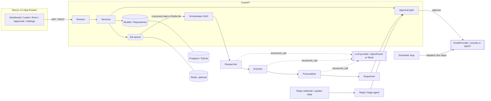

# RevOps Agent Platform

An autonomous, multi-agent sales pipeline with a **human approval gate**. Sign up, create an org, add leads (manually or via CSV), and launch an agent run per lead. A team of specialised agents researches the lead, scores ICP fit, writes a tailored email sequence and schedules it, then **pauses for a human to approve** before anything is sent. Replies (pasted or via webhook) are classified and answered by a triage agent. Every step is traced with input, output, tokens, latency and cost.

Everything runs **offline with no API key** using a deterministic mock LLM (`LLM_PROVIDER=mock`), so demos and the full test suite need no external services.

## Features

- **Five agents**, each its own module with a prompt, tools and a Pydantic-validated structured output: Researcher, Enricher, Personalizer, Sequencer (deterministic), Reply Triage.
- **DAG orchestrator** with a shared run state, per-step persistence (trace: agent, input, output, tool calls, tokens, latency, cost, attempts) and a **pause at the approval gate**.
- **Approval queue UI**: review, edit, approve or reject each draft. Step 1 sends on approval; later steps are sent by the scheduler when due.
- **Pluggable `EmailProvider`**: `console` (log only, default) and `smtp` (aiosmtplib), selected by env.
- **LLM layer**: OpenRouter (OpenAI-compatible) with per-agent model env vars, JSON-schema structured output, Pydantic validation with retry-with-feedback, token and cost accounting, and **per-org monthly token limits**.
- **Auth and tenancy**: email + password (argon2), JWT access/refresh, Google and GitHub OAuth2 (hand-rolled code flow; buttons disabled when unconfigured), orgs with owner/admin/member roles, invitations, every query tenant-scoped.
- **Leads**: CRUD, filters, pagination, CSV import with header aliasing, dedupe and per-row errors.
- **Reply triage**: interested / objection / out-of-office / unsubscribe / other, with draft replies; unsubscribes cancel open sequences and block outreach. Inbound webhook per org.
- **Ops**: structured JSON logs, `/health` and `/ready`, rate limiting (Redis or in-process), Redis job queue with a separate worker (falls back to in-process asyncio tasks), Alembic migrations, Docker, CI.
- **Dashboard**: KPI cards, pipeline funnel, runs chart, live run timeline/trace viewer (polling, plus an SSE endpoint), leads table, settings (org/ICP, members, API usage, integrations). Dark-first, responsive, with empty/loading/error states.

## Architecture



Run lifecycle: `queued -> running -> awaiting_approval -> scheduled -> completed` (or `failed`, `rejected`, `cancelled`). Nothing is emailed in `awaiting_approval`.

```
backend/app/
  core/          config, security (argon2/JWT), logging, errors, rate limiting
  models/        SQLAlchemy 2.0 models
  schemas/       Pydantic API schemas
  repositories/  tenant-scoped queries
  services/      auth, orgs, leads, runs, approvals, usage, email providers, oauth, jobs
  routers/       FastAPI routers (thin)
  llm/           provider interface, OpenRouter, MockLLM, structured_call (validate + retry)
  agents/        base Agent + tools, 5 agents, registry (DAGs), orchestrator
frontend/src/    app router pages, components/ui (local shadcn-style), lib (api client, auth, hooks)
```

## Quickstart

### Local (no Docker, no API key)

```bash
make install                 # venv + npm ci
make seed                    # demo org: demo@revops.dev / demo-password-123 (SQLite, mock LLM)
make dev-api                 # http://localhost:8000  (docs at /docs)
make dev-web                 # http://localhost:3000
```

Sign in with the demo account, open **Leads**, select a lead and click **Run agents**, then review the drafts in **Approvals**. Paste a reply on a lead's page to try triage.

### Docker Compose (Postgres + Redis + API + worker + web)

```bash
cp .env.example .env         # set JWT_SECRET (openssl rand -hex 32); optionally LLM_PROVIDER=openrouter + OPENROUTER_API_KEY
docker compose up --build    # web :3000, api :8000
docker compose exec api python -m scripts.seed   # optional demo data
```

### Tests and checks

```bash
make test        # pytest (SQLite + MockLLM, no network)
make lint        # ruff + next lint
make typecheck   # tsc --noEmit
make build       # next build
```

## Environment variables

See [`.env.example`](.env.example) for the full annotated list. Key variables:

| Variable | Default | Purpose |
|---|---|---|
| `DATABASE_URL` | `sqlite+aiosqlite:///./revops.db` | SQLAlchemy URL (`postgresql+asyncpg://...` in prod; `postgres://` is normalised) |
| `JWT_SECRET` | dev value | **Required in production** (the API refuses to start otherwise) |
| `REDIS_URL` | unset | Enables Redis job queue + shared rate limiting; requires the worker process |
| `AUTO_CREATE_TABLES` | `true` | Dev convenience; use `alembic upgrade head` in production |
| `LLM_PROVIDER` | `mock` | `mock` or `openrouter` |
| `OPENROUTER_API_KEY` | unset | Never hard-coded; required for `openrouter` |
| `MODEL_DEFAULT`, `MODEL_RESEARCHER`, `MODEL_ENRICHER`, `MODEL_PERSONALIZER`, `MODEL_TRIAGE` | gpt-4o-mini / haiku for personalizer | Per-agent model selection |
| `DEFAULT_MONTHLY_TOKEN_LIMIT` | `500000` | Per-org default; editable in Settings |
| `EMAIL_PROVIDER` | `console` | `console` or `smtp` (`SMTP_HOST`, `SMTP_PORT`, `SMTP_USERNAME`, `SMTP_PASSWORD`, `EMAIL_FROM`) |
| `GOOGLE_CLIENT_ID/SECRET`, `GITHUB_CLIENT_ID/SECRET` | unset | SSO; buttons are disabled when missing |
| `API_PUBLIC_URL`, `FRONTEND_URL`, `CORS_ORIGINS` | localhost | OAuth redirect URIs and CORS |
| `ENABLE_WEB_TOOLS` | `false` | Lets the Researcher fetch the lead's homepage (public hosts only) |
| `NEXT_PUBLIC_API_URL` | `http://localhost:8000` | Frontend API base, baked in at build time |

**OAuth apps:** register redirect URIs `{API_PUBLIC_URL}/auth/oauth/google/callback` and `{API_PUBLIC_URL}/auth/oauth/github/callback`.

## API overview

Interactive docs at `/docs`. All routes except auth, health and the reply webhook require `Authorization: Bearer <access token>` and are scoped to the token's org.

| Area | Endpoints |
|---|---|
| Auth | `POST /auth/signup`, `/auth/login`, `/auth/refresh`, `/auth/switch-org`, `/auth/accept-invite`; `GET /auth/me`; `GET /auth/oauth/providers`, `/auth/oauth/{google\|github}/login` and `/callback` |
| Org | `GET/PATCH /orgs/current`; `GET /orgs/current/members`; `PATCH/DELETE /orgs/current/members/{id}`; `POST /orgs/current/invitations` |
| Leads | `GET/POST /leads`, `POST /leads/import` (CSV), `GET/PATCH/DELETE /leads/{id}`, `GET /leads/{id}/approvals`, `GET/POST /leads/{id}/replies` |
| Runs | `POST /leads/{id}/runs`, `POST /runs/bulk`, `GET /runs`, `GET /runs/{id}` (full trace), `POST /runs/{id}/cancel`, `GET /runs/{id}/events` (SSE; `?token=`) |
| Approvals | `GET /approvals?status=`, `PATCH /approvals/{id}`, `POST /approvals/{id}/approve`, `/reject`, `POST /approvals/dispatch-due` |
| Insights | `GET /dashboard/stats`, `GET /usage`, `GET /integrations`, `GET /agents` |
| Webhook | `POST /webhooks/replies/{org_webhook_token}` with `{"from_email", "body"}` |
| Ops | `GET /health`, `GET /ready` |

### Example

```bash
curl -s -XPOST localhost:8000/auth/signup -H 'content-type: application/json' \
  -d '{"email":"me@example.com","password":"correct-horse","name":"Me","org_name":"Acme"}'
# -> {"access_token": "...", "refresh_token": "..."}
curl -s -XPOST localhost:8000/leads -H "Authorization: Bearer $TOKEN" -H 'content-type: application/json' \
  -d '{"email":"ceo@startup.io","first_name":"Ada","company":"Startup","title":"CEO"}'
curl -s -XPOST localhost:8000/leads/$LEAD_ID/runs -H "Authorization: Bearer $TOKEN" -H 'content-type: application/json' -d '{}'
curl -s localhost:8000/runs/$RUN_ID -H "Authorization: Bearer $TOKEN"   # steps, tokens, cost, drafts
```

## Deployment

### Docker Compose (single host)
`docker compose up -d --build` with a `.env` containing at least `JWT_SECRET`. The API container runs `alembic upgrade head` on boot. Put a TLS reverse proxy (Caddy, nginx, Traefik) in front, and set `API_PUBLIC_URL`, `FRONTEND_URL`, `CORS_ORIGINS` and `NEXT_PUBLIC_API_URL` (rebuild `web` when the latter changes).

### Render / Railway / Fly.io (API + worker)
- Create a managed Postgres and (optionally) Redis; set `DATABASE_URL`, `REDIS_URL`, `JWT_SECRET`, `AUTO_CREATE_TABLES=false`, `CORS_ORIGINS`, `FRONTEND_URL`, `API_PUBLIC_URL`.
- Deploy `backend/` from its Dockerfile as the web service (port 8000, health check `/health`). Add a second service from the same image with start command `python -m app.worker` **if you set `REDIS_URL`**. Without Redis a single API instance runs jobs and the scheduler in-process (do not scale it beyond one replica in that mode).
- Fly.io: `fly launch --dockerfile backend/Dockerfile`, `fly secrets set ...`, and define a `worker` process in `fly.toml`.

### Vercel (frontend)
Import the repo, set the root directory to `frontend/`, and set `NEXT_PUBLIC_API_URL` to the public API URL. Add the Vercel domain to the API's `CORS_ORIGINS` and `FRONTEND_URL`.

## Security notes

Passwords use argon2; refresh and access JWTs are type-checked; all repositories filter by `org_id`; OAuth `state` is a signed short-lived token; homepage fetching is SSRF-guarded and off by default; secrets only come from the environment. OAuth tokens are delivered to the SPA in the URL fragment and stored in `localStorage`, a common SPA trade-off; harden with httpOnly cookies if your threat model requires it.

## License

MIT. See [LICENSE](LICENSE).
